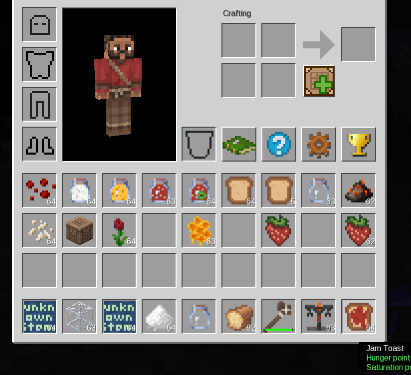

# leo_mcl_addons

A [Mineclonia](https://codeberg.org/mineclonia/mineclonia) addon that adds
strawberries, strawberry preserves and bread-based foods.

## Content

- **Strawberry** — a small berry food item. Crafting one yields a single
  strawberry seed (like a melon slice yields a melon seed).
- **Strawberry Seeds** — place on farmland (created with a hoe) to grow a
  strawberry plant. Plants grow in 5 stages, faster on hydrated farmland and in
  sunlight. Immature plants drop one strawberry when harvested; mature plants
  always drop one strawberry and drop a second one 40% of the time.
- **Red tulips** — digging a `mcl_flowers:tulip_red` has a 50% chance to drop a
  strawberry instead of the tulip.
- **Glass Jar** — crafted from seven glass in a U/beaker shape. Doubles as a
  brewing container (it carries the `empty_bottle` group).
- **Sugar Syrup Jar / Honey Jar** — intermediate brews: a jar plus sugar (or a
  honeycomb) in a brewing stand. Not food.
- **Strawberry Jam** — brewed from a sugar syrup jar and a strawberry in
  a brewing stand. Twice as filling as a raw strawberry; eating it returns the
  empty jar.
- **Bio Jam** — the gentler preserve, brewed from a honey jar and a
  strawberry. Same values as the regular jam.
- **Placed Bread** — rightclick a solid surface while holding bread to place a
  loaf on it instead of eating the bread. Breaking the loaf with an axe of any
  material drops three toast slices.
- **Toast** — a slice of bread. Two hunger icons, generous saturation.
- **Jam Toast** — crafted shapeless from one toast and one jam. The
  strongest food in the addon: eight hunger points.

## Usage

1. Craft or find a strawberry, then craft it into a seed.
2. Hoe some dirt into farmland, water it, and plant the seeds.
3. Harvest mature plants for strawberries.
4. Brew a jar with sugar (or a honeycomb) into a sugar syrup jar (or honey
   jar), then brew that with a strawberry into jam (or bio jam).
5. Place bread with a rightclick, chop the loaf with an axe for toast, and
   spread jam on it in a crafting grid for jam toast.

## Screenshot

## License

Copyright (C) 2026 Philipp Leonhardt

The mod **code** is licensed under the GNU General Public License version 3
(or, at your option, any later version). See [LICENSE.txt](LICENSE.txt) for the
full text.

## Media

**Textures and models** are licensed under CC-BY-SA 4.0.
